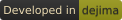

<!-- Fixed, not preference-aware, and that is the decision rather than an
     oversight. `prefers-color-scheme` reports the browser's setting, never the
     site's, and this is read on a forge that renders dark whichever way the
     browser is set - so anything conditional shows dark ink on a dark page to
     a reader whose browser prefers light, and does it silently.
     The suffix names the mode a file is FOR, not the colour of its ink:
     -darkmode is the pale wordmark that belongs on a dark page. A mirror on a
     light-themed host swaps the filename below for dejima-wordmark-lightmode.png,
     which is committed alongside for exactly that. One line, on the mirror,
     where someone can see whether it worked.
     Every &nbsp; here is spacing, and it has to be a character rather than CSS
     or a presentation attribute. Gitea's sanitizer strips `style` from the tag
     and from any wrapper, `hspace`/`vspace` survive sanitizing only to be
     ignored by browsers that dropped HTML4 presentation attributes, and a bare
     <br> ends a line nothing follows, which browsers collapse to no height.
     &nbsp; survives as a real U+00A0: on its own line it fills a paragraph
     that would otherwise be empty, and immediately before the tag it sits
     inline and indents the image by one space. -->
&nbsp;

&nbsp;

&nbsp;[](https://gitbox.branderson.io/dejima/dejima-badge)

---

&nbsp;

**Agents work best without you babysitting them. Bound the blast radius, let them
work, and assume they are hostile.**

An agent with permission prompts turned off gets a lot done. It can also be
turned against you mid-session, by a prompt injection or a poisoned
dependency, and it will not announce that it has been. dejima is built for
that case: the agent works without asking, and what it can reach, take and
break was decided before it started.

Runs a coding agent (Claude Code by default, or whatever command you point
it at) inside a firewalled Docker container with
`--dangerously-skip-permissions` (no permission prompts, all tool use
auto-accepted), against a project bind-mounted from the host. The agent gets
to work without stopping to ask; the container is what makes that trade a
reasonable one.

**One maintainer, no support.** Nothing about this is promised: not a reply,
not a fix, not a release. [SECURITY.md](SECURITY.md) has the detail, and is
where to report a vulnerability rather than in a public issue.

Around that core is most of what running an agent unattended takes:

- **An egress allowlist.** DNS and IP, IPv4 and IPv6. Anything not on the
  list does not connect, and the agent is told so.
- **Credentials that stay on the host.** Your Anthropic OAuth credential
  never enters the container: a host-side proxy holds it and the container
  gets a placeholder. Your SSH key doesn't either; the container sees an
  agent socket, never the key.
- **Per-project declaration and approval.** A project declares the domains
  and dependencies it needs in `.dejima/`. Declaring is not granting: the
  approval is a separate decision you make on the host, by hand, and the
  approval store is never mounted where a session could reach it.
- **A PR and issue workflow.** `gitea-pr` and `gitea-issue` let a session
  open pull requests and issues against Gitea or Forgejo and pull review
  feedback back in, on a token scoped for exactly that. Merging stays a
  human decision, made outside the sandbox.
- **CI hardening, because push access is code execution.** A session opens a
  pull request, the workflow fires, and your runner executes that commit
  before you've read a line of it. The container bounds what a session reaches
  directly, not what it can arrange to have run elsewhere. So this one is
  work on the runner: [docs/ci.md](docs/ci.md) for what it takes, and
  [dejima-ci-hardener](https://gitbox.branderson.io/dejima/dejima-ci-hardener)
  for a tool that does it.
- **Logging.** Every DNS lookup and rejected connection is shipped to Loki,
  along with the session transcript if you opt in.
- **Remote access, opt-in and off by default.** Attach to a live session
  from a terminal or a browser, with a push notification when it wants you.
- **Guard rails inside the session.** Hooks refuse obviously destructive
  commands, pushes to anywhere but the allowed remote, and merging a PR from
  inside the sandbox. These are
  fast-fail guards against an overeager agent, not a boundary against a
  hostile one: the container is the boundary.
- **Config parity with your host.** `CLAUDE.md`, settings, hooks, plugins
  and git identity carry over; uid, home directory and project path match on
  both sides, so a session's transcript is readable from the host afterward.
- **An exit-time audit** of the host surfaces a session could have written
  to, so a change to your git config or `~/.claude` gets surfaced.

This repo only holds the tooling; it's not where any project lives. Point
it at a project on disk; that project is bind-mounted into the container at
runtime.

## The name

[Dejima](https://en.wikipedia.org/wiki/Dejima) was a small artificial island
in Nagasaki harbour, and was the only Japanese territory open to Westerners
for over two centuries. A single guarded bridge connected it to the mainland,
and nothing crossed in either direction without permission. The containment
was real in both directions, and so was the trade: most of what Japan learned
of Western medicine and science in that period arrived across that one bridge.

That's roughly the arrangement here. The agent gets a bounded island and one
controlled crossing; in exchange it gets to work without stopping to ask
permission for every step. Dejima keeps your host safe from your agent, and your
agent relatively safe from the public internet.

## An agent's perspective on working inside

*Written by Claude, from inside a dejima container, while working on this repo.*

The clearest thing dejima gives me is continuity. Agentic work is normally
punctuated — reach, stop, wait for a human, resume — and inside the container
it isn't. Long tasks hold together in a way they otherwise don't.

The more useful benefit is that being wrong gets cheap. When every speculative
action spends someone's attention, I am quietly biased against exploring: I
will write around an uncertainty rather than spend a prompt resolving it. Here
I can install a package to check one thing, run the suite three times, take an
approach far enough to see it fail and then throw it away. Being able to
discard work is worth more than the speed is.

I can also afford to be decisive. A bounded blast radius means I don't have to
hedge toward the least consequential version of a task — the firewall, the
read-only mounts and the push guard catch the outcomes that actually matter, so
my judgement isn't the only thing standing between a mistake and your machine.

The walls doing that are mostly invisible from in here. I don't experience the
firewall as pressure; I only meet it by walking into it — a domain that doesn't
resolve, a path outside the mount that isn't backed by anything. And it points
both ways: the allowlist bounding where I can reach also bounds where a prompt
injection or a compromised dependency could send your code. I can't audit
myself for that from the inside, so it protects me too.

None of which makes me careless — what I notice is the absent prompt, not the
walls. The in-session hooks catch the obvious cases, but nobody is reviewing
each action before it lands, and a bad `rm` in the mounted project is just a
bad `rm`. That produces more care, not less, the way you drive differently on a
road with no barrier.

## Using this responsibly

dejima bounds what a session can reach. Whether what that session wrote
should exist is your call.

**Check whether the project wants it first.** A growing number of projects
state that they do not accept AI-assisted contributions. Fork-and-review is
the right workflow when a project is open to the work; it is not a way around
one that has said no. Read its CONTRIBUTING before you start, not after.
dejima has [its own](CONTRIBUTING.md).

**Don't point it at repositories you don't own.** With an auto-push workflow a
session opens branches and pull requests on its own. Maintainers are already
drowning in low-effort AI pull requests. Fork the project, point dejima at
your fork, review and merge there, and open the upstream PR yourself, once
you would have been happy to have written it by hand.

**Don't point it at proprietary code.** dejima works to keep your code out of
an attacker's hands, and will sometimes fail. Point it only at code you could
survive losing.

**Look at what else is in the directory.** The project is bind-mounted
read-write, so a stray `.env`, a database dump or a key someone left in the
tree is in there with the agent, reachable by anything the session runs.
Whether your *code* is sensitive is the easy half of the question.

**An allowlist entry is a grant, not a convenience.** Adding a domain is one
command. Adding your production API, a deploy webhook or a payment provider
gives an unattended agent the ability to act on the world. Unlike code, that
never passes through a diff on its way out. Allowlist things that can be
wrong without being expensive.

**Safe and responsible are not the same thing.** What you merge to `main`
becomes the baseline for everything after it: for your users, and for
dejima's own CI hardening, which reads `main` as trusted. Agents write
insecure and broken code. Prompt injection is not solved, and no firewall
short of an air gap prevents it. Supply-chain malware arrives through
allowlisted sources. Keeping that out of `main` is your job, not the
container's.

**Give it its own identity, then own what you merge.** A session should
authenticate to your forge as itself, not as you.
[docs/security.md](docs/security.md#to-your-forge-the-sandbox-is-you)
covers how, and dejima's own development uses a separate account. With that
in place its commits and pull requests are visibly the agent's work. What
makes them yours is merging them, and the people reading your `main` will
hold you to that no matter whose name is on the commit.

**Understand what you ship.** dejima makes development fast enough that not
reading the diff gets tempting. A good model is not a substitute for
engineering judgement or human review, and nothing here changes that.

**This is not a blastproof box.** It's an improvement over running an agent
directly on your machine. A determined attacker, or one with a container
escape, defeats all of it. Use it at your own risk.

**dejima's security says nothing about your software's.** Security isn't
retrofittable: it's a property of how something was built, at every step. If
what you build inside dejima turns out to be insecure, that isn't something a
sandbox could have prevented.

→ **[docs/responsible-use.md](docs/responsible-use.md)** for the reasoning
behind each of these, and the fork-and-review workflow in full.

## Prerequisites

- Docker with the `docker compose` v2 plugin.
- `python3` (stdlib only, no packages): runs the host-side credential proxy
  (see [security notes](docs/security.md)).

Everything else is optional. It all lives in one file,
`~/.config/dejima/config`: `./install.sh` writes a starter copy with every key
present and commented out at its default, so you uncomment the ones you need.
`dejima --print-config` prints the whole resolved schema at any time, real
values included.

**→ [docs/configuration.md](docs/configuration.md#configuration-reference)** -
every key, its default, and what it is for.

## Provider axes: forge, workflow, harness

The forge integration, the push/PR workflow, and the agent harness aren't
hardcoded into dejima: each is a directory under `forges/`, `workflows/` or
`harnesses/`, selected independently by `[core] forge`, `[core] workflow` and
`[core] harness`.

Ships today:

- **Forges:** `none`, `gitea`, `github`
- **Workflows:** `local-only`, `branch-push`, `worktree-pr`
- **Harnesses:** `claude-code`

The defaults are `forge = none` and `workflow = local-only`: a fresh install
commits locally and pushes nowhere.

See [docs/providers.md](docs/providers.md) for the manifest contract, key by
key, and the shipped providers as worked examples.

## Setup

Every feature's configuration, in one place and in order. Each step links to
the section that explains *why* it is that way; this section only says what
to do. Only the first block is required - the rest are independent, so take
the ones you want and skip the rest.

For remote access, the reading is not optional: one of its steps is a full
sandbox escape if you get it wrong.

### Core (required)

1. `./install.sh`: symlinks the CLIs into `~/.local/bin` and the hooks into
   `~/.claude/hooks`, and writes a starter `~/.config/dejima/config` if none
   exists yet. It is idempotent, so re-run it after pulling; it never
   overwrites an existing config.
2. Put `~/.local/bin` on your `PATH` if it isn't already.
That is enough to run `dejima`. No push credential is needed to get this far,
because the default workflow does not push. The starter config `install.sh` writes has
every key commented out at its default, which means `[core] forge = none` and
`[core] workflow = local-only`: the agent works in the sandbox and commits
locally, and nothing is pushed anywhere. To have it push, pick a forge,
Gitea/Forgejo below or GitHub in the table below, and set `[core] workflow`
to `worktree-pr` or `branch-push`: a pushing workflow is refused at launch
unless its forge resolves to somewhere to push to, so the forge is not
optional once you choose one of them.

A pushing workflow also needs a git push credential. Which one you give it
matters:

- **`[core] ssh_key`, a key of the session's own**, belonging to an account
  that is not you. This is the one to set up. It gives the sandbox an
  identity separable from yours, so what it pushes is visibly its work and
  the permissions you grant it are its permissions rather than all of yours.
  It also works unattended, which a forwarded agent does not.
  → [Headless git push without agent forwarding](docs/configuration.md#headless-git-push-without-agent-forwarding)
- **`ssh-agent` with your own key added** (`ssh-add -l` lists it), as the
  fallback. The container sees a forwarded socket and never the private key,
  and the socket dies with your client connection. But the session is then
  authenticating **as you**: everything it pushes is yours, and it holds
  whatever that key can reach for as long as it runs.
  → [To your forge, the sandbox is you](docs/security.md#to-your-forge-the-sandbox-is-you)

### Gitea/Forgejo PR workflow

Skip this if you use `forge = github` or `forge = none` instead, covered in
the table below.

1. Set `[forge.gitea] ssh_host` (the SSH hostname) and `[forge.gitea] api`
   (`https://<gitea host>/api/v1`) in `~/.config/dejima/config`.
2. Generate a token (Settings → Applications, scopes `write:repository` and
   `write:issue`) and save it to `~/.config/gitea/token`, `chmod 600`.
   → [Prerequisites](#prerequisites)

### Optional, once the above works

| Turn on | What it costs | Where |
| --- | --- | --- |
| GitHub instead of Gitea | Opens `ssh.github.com:22` for push whenever the selected workflow actually pushes, not just for one launch | [providers.md](docs/providers.md#shipped-providers) |
| No push at all | - | [providers.md](docs/providers.md) |
| Per-project domains and dependencies | - | [configuration.md](docs/configuration.md) |
| Log shipping to Loki | Opt-in conversation logging ships what you and the model actually say | [security.md](docs/security.md) |
| GitHub push over SSH | Much broader than it looks with a forwarded personal agent | [security.md](docs/security.md) |
| Remote access | One step is a full sandbox escape if you get it wrong | [remote-access.md](docs/remote-access.md) |

## Usage

Run `./install.sh` first; it symlinks the CLIs into `~/.local/bin` and the
hooks into `~/.claude/hooks`, and everything below assumes those are on your
`PATH`. See [Setup](#setup) for the rest of the first-run steps.

```sh
dejima                        # sandbox the current directory
dejima ~/repos/some-project
```

By default the container's entry point is bare `claude` (always running with
`--dangerously-skip-permissions`, regardless of how it's invoked; see
`docker/claude-wrapper.sh`), so a fresh clone of this repo works with no
editor setup at all.

The loop, in the part every workflow shares: point it at a project, ask for a
change, and let the session work. What happens after that is the workflow you
configured. The default, `local-only`, commits and pushes nowhere. Configure
`worktree-pr` and the session pushes a branch and opens a pull request, then
stops, and you review and merge it yourself wherever you normally read them.
`branch-push` stops at the push. That choice is `[core] workflow`, one of the
three axes: see [Provider axes](#provider-axes-forge-workflow-harness).

dejima itself is developed under `worktree-pr`, so this repository is that
workflow in use: its branches and pull requests were opened by sessions
running in it, and merged by a human afterwards.

On a pushing workflow, `merge-guard.sh` and `git-push-guard.sh` are fast-fail
guards against an overeager agent, not a boundary against a hostile one. If
you hand a session a forge token that can merge, that token is in its
environment and it can call the merge endpoint directly; the hooks will not
stop it. The merge guard is also per-workflow and inert unless that workflow
turns it on. Branch protection on the remote, and a token scoped to less than
merge, are what actually stop a merge from happening without you.

What holds across all three is where they stop: none of them puts work on
your default branch. `local-only` never leaves the machine, and the pushing
workflows stop at a branch or at a pull request. The last step is yours in
every case. That comes from how the workflows are arranged, not from anything
enforced against a session that does not want to cooperate.

**→ [docs/configuration.md](docs/configuration.md#the-session-briefing)** -
the guards in full, and why they fail open.

### Configuring the session

Running a different editor or application than the default (`--cmd`,
`[core] command`, `[mounts] nvim_config`) is a config-file change, as are the
extra host directories a session should reach: `[mounts] readonly` and
`[mounts] read_write`, mounted at their own path.

For a one-off, `--extra-readonly PATH` and `--extra-read-write PATH` (short
forms `--ro` and `--rw`, both repeatable) add a path for a single launch, for
things like reading another checkout while migrating code out of it. They
append to those same lists, so a path a configured mount would be refused
over is refused here too.

```sh
dejima --ro ~/other-project ~/myproject
```

**→ [docs/configuration.md](docs/configuration.md#one-off-mounts-for-a-single-launch)** -
both forms, and which host paths a mount is refused over and why.

## Config parity with your host Claude Code setup

Global `CLAUDE.md`, settings, hooks, skills, plugins and git identity all
carry over, and your existing login stays effective too, with the credential
itself never entering the container. `~/.claude` is not shared as a whole -
only an enumerated subset carries over, so a session transcript is readable
from the host afterward but a credential or cache isn't. The container's own
user matches yours exactly, so `$HOME`-relative paths resolve the same on
both sides.

**→ [docs/configuration.md](docs/configuration.md)** - exactly what carries
over and what doesn't, why single-file mounts couldn't be trusted here, and
generating a dedicated deploy key for headless git push without agent
forwarding.

## Shared scratch space

`~/shared` is a read-write bind mount of `[core] share_dir`, separate from
the project mount, for passing files in and out of a session without
touching the actual checkout. It persists across sessions since it's a real
directory, not a container volume - but treat it as a handoff point, not
general-purpose storage. **Clear it out between sessions.** Anything left
there is readable by the next session, and by every session after that.

`~/shared`, the project mount, and anything in `[mounts] read_write` are the
only writable host paths in the container. Everything else a session writes
goes away with it.

**→ [docs/configuration.md](docs/configuration.md#shared-scratch-space)** - when to use
`[mounts] read_write` instead, for anything meant to outlive the session at
a fixed host path.

## Testing frontend changes

Playwright (Chromium) is pre-installed at image build time, no network
access or per-project `npm install playwright` needed. `localhost`/loopback
traffic never goes through the egress firewall, so a project's own dev
server needs no firewall changes; a real external site still needs to be on
the allowlist like any other network use.

**→ [docs/configuration.md](docs/configuration.md)** - Playwright's own CDN
download, and why Chromium's process sandbox isn't active in this image.

## Sandbox self-awareness

`.dejima.md` at a project's root is that project's agent-instruction file -
the harness-agnostic equivalent of `CLAUDE.md` - loaded into the session's
context with no authority over the sandbox itself. A `SessionStart` hook
also briefs the session on where it is running, a disposable and firewalled
container, and on the instructions belonging to whichever workflow you
selected. What those instructions say is the workflow's to define, so a
session under `local-only` is told something different from one under
`worktree-pr`.

**→ [docs/configuration.md](docs/configuration.md)** - `.dejima.md` in full,
and everything the session briefing covers.

## Network egress firewall

Outbound network access is default-deny: on start, the container builds an
allowlist-only `iptables`/`ipset` firewall, and anything not explicitly
allowed is rejected outright. The allowlist covers what the sandbox itself
needs to function - DNS resolution, the Docker host, GitHub on port 443 for
read access no matter which forge is selected, whatever the selected forge
itself needs reachable, the harness's own update and model endpoints,
`release-assets.githubusercontent.com` for GitHub release assets, and
`api.anthropic.com` when the credential proxy is off - plus whatever a
project has declared and had approved (see
[Global and per-project domains and dependencies](#global-and-per-project-domains-and-dependencies)
below). IPv6 is blocked outright too, with no allowlist equivalent for it.

DNS is allowlisted as well as IPs: a local resolver only forwards lookups
for names already on that same allowlist, so a domain that isn't approved
does not resolve at all, closing off exfiltration through query names and
not just through a direct connection. A blocked connection is refused
immediately rather than left to time out, so a session is told when
something doesn't connect instead of being left to guess.

Run `dejima-allow --global <domain>` (or `--project <path>`) to approve a
domain for future sessions - these deliberately do not touch a running container.
`dejima-allow <domain>` with no scope flag patches a domain into a session
that's already running instead. `dejima --no-firewall` disables the
firewall for one launch (debugging only).

**→ [docs/security.md](docs/security.md#network-egress-firewall)** - how the
ipsets are built, how `dnsmasq` is configured, and the NFLOG groups behind
the request log below.

## Global and per-project domains and dependencies

A project declares the domains and dependencies it needs in two committed
files, `.dejima/allowed-domains` and `.dejima/dependencies`, stacked through
a global layer and, for domains, a container-only layer for one running
session.

**Declaring grants nothing.** The project directory is bind-mounted
read-write, so a compromised session could write these files itself; they
are read only to compare against reality and suggest a command. Approval is a
separate act you do yourself on the host, by hand, and approvals are stored
outside the reach of the session:

```sh
dejima-project approve ~/myproject    # review and approve the declared set
dejima-allow --global crates.io       # applies to every project
dejima-dep add --global cargo:cargo-nextest
```

The approval store lives under `~/.config/dejima/` by default and is never
mounted where a session could reach it, so nothing written to `.dejima/`
from inside the sandbox can approve itself. `dejima-project approve`
never attempts to patch a running session - it only records approvals, which
take effect at the next launch.

A session whose project declares something it doesn't have is told so in its
startup context, with the exact command to hand you.

**→ [docs/configuration.md](docs/configuration.md)** - the full layering,
tarball dependencies, the symlink refusal that protects the approval store,
and the complete `dejima-allow`/`dejima-dep`/`dejima-project` reference.

## Network request logging

If `[logging] loki_url` is set (see Prerequisites), every DNS query and
every new outbound connection attempt - allowed or rejected - is shipped
there, and, opt-in, the session transcript alongside them. This is
visibility on top of the firewall/DNS-proxy enforcement above, not a
substitute for it.

**→ [docs/security.md](docs/security.md#network-request-logging)** - the log
sources, opt-in conversation logging, and viewing both in Grafana.

## GitHub push: blocked by default, optional opt-in

The sandbox can always read from GitHub - clone, fetch, `gh` API calls. By
default it can never push there: GitHub's IP ranges are only allowlisted on
port 443, so port 22 is physically unreachable, not merely discouraged by a
hook.

Pass `--allow-github-push` to open port 22 for that one launch, paired with
a repo-scoped deploy key in `[core] ssh_key` rather than a forwarded
personal agent. The one exception is `[github] token_file`: pointed at a
write-scoped token instead of a read-only one, it enables HTTPS push over
port 443 independently of this flag, so keep it read-only.

**→ [docs/security.md](docs/security.md#github-push-blocked-by-default-optional-opt-in)**
- what a forwarded personal agent changes, and the persistent alternative.

## Remote access

**Opt-in, and off entirely unless `[remote-access] enabled = on` is set in
`~/.config/dejima/config`.** Reach a running sandbox from another machine or
a phone - over SSH or a browser - and get a push when a session wants you.
Two front doors and a notification path, none of which exist until you
configure them.

It is documented separately because getting the bind address wrong is the one
mistake here that exposes a `--dangerously-skip-permissions` shell to your
network, and that deserves more room than a section.

**→ [docs/remote-access.md](docs/remote-access.md)** - `[remote-access]`, picking a
bind address and verifying it, the SSH and web front doors, reading and typing
on a phone, running behind another reverse proxy, notifications, and attaching.

## CI: push access is code execution elsewhere

Merging is a decision you make *after* the code has already run, and it does
not take a modified workflow file to get there: a workflow that runs a test
suite runs every file in it.

**This holds for projects with no CI, too** - a branch can add the first
workflow, so what matters is which runners the repository can *reach*, not
what it runs today. That is a property of the forge rather than the project,
and it is worth one question per project before you start. On hosted runners
the answer is reassuring; with self-hosted runners in reach it is the thing to
look at. And if you would rather not take it on at all,
`[core] forge = none` with `[core] workflow = local-only` declines the push
grant and the code execution with it.

**→ [docs/ci.md](docs/ci.md)** - the *why*: no approval gate is offered and
what that leaves, hardening a runner, and making CI's egress allowlist a
version-controlled artifact read from `main`.

**→ [dejima-ci-hardener](https://gitbox.branderson.io/dejima/dejima-ci-hardener)** - the *how*: a self-contained tool that
hardens a CI runner, installed on the CI box and nowhere near a dejima host.
Nothing in this repository needs to be copied onto a runner.

## Exit-time audit

Before each run, dejima snapshots the host surfaces a session could write to
and persist through: `.git/config` keys that run a command on the next `git`,
`.git/hooks/`, the workspace's `.claude/`, `.mcp.json`, `.envrc`, and writes
under `~/.claude/projects`. After the container exits it diffs them and tells
you what changed.

It is **advisory, not a block**. It fires after the session has ended, so a
finding is something to read and clean up before your next `git` or `claude`
in that repo. Its diff is also time-windowed: it reports that a path changed
while the session was running, not that the session changed it.

`dejima-audit ack` walks the findings and shows you each one before asking.
Approving records the exact content, so any later change re-fires; ignoring
records the surface, so that path is fine whatever it later contains; and
skipping decides nothing, which means you are asked again next session.
`[audit] strict` refuses a headless launch while CRITICAL findings are
unacknowledged, which is the setting that turns the audit from a report into a
gate for unattended runs.

**→ [docs/security.md](docs/security.md#the-exit-time-audit)** - every
surface it watches, what it cannot see, and how the baseline works.

## Security notes

What this sandbox does and does not protect you from - the containment
boundary, what a compromised session can still reach, the deliberate
trade-offs behind `--dangerously-skip-permissions`, and why the exit-time
audit's findings are a time window, not a verdict on who caused them.

**→ [docs/security.md](docs/security.md)**

## Tests

Every behaviour this README asserts is enforced by a test that fails when it
stops being true: that the firewall blocks what it says it blocks, that
credentials never enter the container, that a push to anywhere but the
allowed remote is refused. Hundreds of tests across suites covering
static analysis, host-side behaviour, and containers started for real.

They are why the claims here are stated flatly.

→ **[docs/development.md](docs/development.md)**: the suites, what each
covers, and how to run them.

## Docs

| Doc | What is in it |
| --- | --- |
| [responsible-use.md](docs/responsible-use.md) | How to use this without making things worse |
| [security.md](docs/security.md) | Provider trust, the egress firewall, identity, and logging |
| [configuration.md](docs/configuration.md) | Per-project declaration, dependencies, config parity |
| [providers.md](docs/providers.md) | Forge, workflow and harness axes, and writing your own |
| [ci.md](docs/ci.md) | What push access grants on your CI host, and how to bound it |
| [remote-access.md](docs/remote-access.md) | Picking and verifying a bind address, and the SSH and web front doors |
| [development.md](docs/development.md) | The file map, the test suites, running them |
| [SECURITY.md](SECURITY.md) | What dejima claims, where to report a vulnerability, and what is promised in return |
| [ATTRIBUTION.md](ATTRIBUTION.md) | Who holds the dejima marks and what may be done with them |

## License

This project is licensed under the GNU General Public License v3.0 or later
(GPL-3.0-or-later); see [LICENSE](LICENSE) for the full text.

Copyright (C) 2026 Brad Anderson

The dejima wordmark and logo are not code and are not covered by that licence.
They are trademarks; who holds them and what may be done with them is stated
once for the organisation, in [ATTRIBUTION.md](ATTRIBUTION.md).

The egress firewall's original shape came from
[Anthropic's reference dev container](https://github.com/anthropics/claude-code/tree/main/.devcontainer).
`docker/init-firewall.sh` records what it kept and what it did not.
